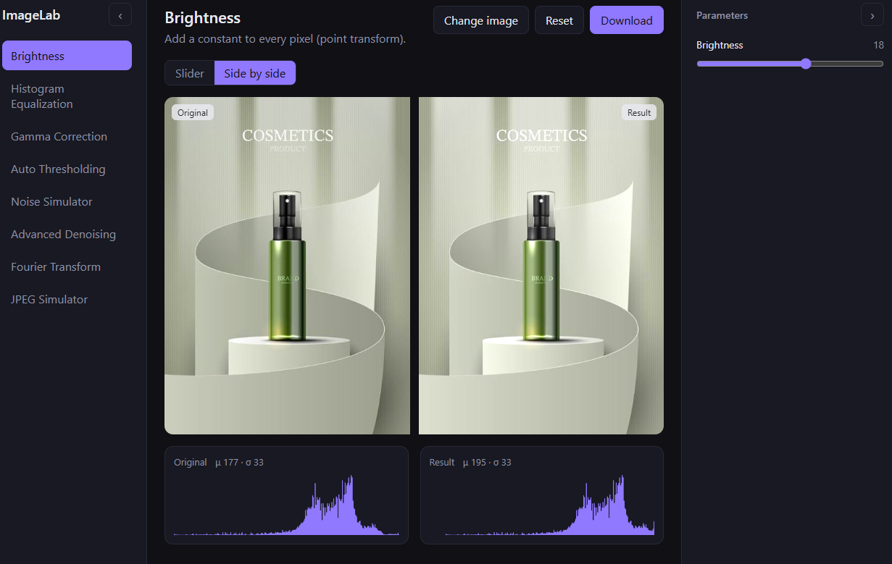
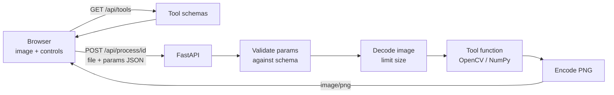
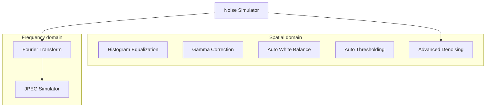

# ImageLab

An interactive web app to learn image processing. Drop an image, pick a tool, move the sliders, and watch the result and its histogram update live, with a before/after slider.

**Stack:** Python 3.12, OpenCV 4, NumPy, FastAPI, plain HTML, CSS and JavaScript (no build step).

## Tools

| Tool | What it does | Main parameters |
|------|--------------|-----------------|
| Histogram Equalization | Boost contrast on the luminance channel only | global or CLAHE, clip limit, tile size |
| Gamma Correction | Non-linear brightness through a lookup table | gamma, all channels or luminance |
| Auto White Balance | Remove a color cast | gray world or white patch, strength |
| Noise Simulator | Add noise to test denoising | Gaussian, salt and pepper, speckle, amount, seed |
| Advanced Denoising | Compare classic denoising filters | mean, Gaussian, median, bilateral, non-local means |
| Auto Thresholding | Binarize an image | manual, Otsu, triangle, adaptive, block size, C |
| Fourier Transform | View and edit the frequency spectrum | spectrum, low-pass, high-pass, periodic noise removal |
| JPEG Simulator | Reproduce JPEG compression artifacts | quality, chroma subsampling, error view |

## How it works



The frontend never hardcodes a tool. It reads each tool's schema from `/api/tools` and builds the menu and the controls from it.

## Run

```powershell
uv sync --managed-python
uv run uvicorn app.main:app --reload
```

- App: http://127.0.0.1:8000/
- API docs: http://127.0.0.1:8000/docs

Run the tests:

```powershell
uv run pytest -q
```

## API

| Method | Route | Purpose |
|--------|-------|---------|
| GET | `/api/tools` | List all tools with their parameter schemas |
| POST | `/api/process/{tool_id}` | Process an image |

`POST /api/process/{tool_id}` takes multipart form data:

| Field | Type | Notes |
|-------|------|-------|
| `file` | image | max 10 MB, downscaled to 1600 px on the longest side |
| `params` | JSON string | missing values use defaults, out-of-range values are rejected |

Returns `image/png`. Errors: `400` for invalid image or parameters, `404` for an unknown tool.

```bash
curl -X POST "http://127.0.0.1:8000/api/process/gamma" \
  -F "file=@samples/test.jpg" \
  -F 'params={"gamma": 2.0, "apply_to": "luminance"}' -o out.png
```

## Project structure

```
ImageLab/
├── app/
│   ├── main.py          # two generic routes, no tool logic
│   ├── registry.py      # Tool and Param definitions, validation
│   ├── utils.py         # decode, encode, size limits
│   └── tools/           # one file per tool
├── static/
│   ├── index.html
│   ├── css/style.css    # design tokens, automatic dark mode
│   └── js/app.js        # schema-driven UI, compare slider, histograms
├── scripts/             # one experiment per concept, with numeric checks
├── tests/               # pytest, synthetic images
├── samples/
└── pyproject.toml
```

## Add a new tool

Create `app/tools/mytool.py`:

```python
from app.registry import Param, Tool, register

def run(img, strength):
    ...  # BGR uint8 array in, array out

register(Tool(
    id="mytool",
    name="My Tool",
    description="One line shown in the UI.",
    params=[Param("strength", "Strength", "float", 1.0, min=0, max=10, step=0.5)],
    func=run,
))
```

Then import it in `app/tools/__init__.py`. The sidebar entry and the sliders appear with no frontend change.

Supported parameter types: `int`, `float` (sliders), `select` (dropdown), `bool` (checkbox).

## Frontend features

| Feature | Detail |
|---------|--------|
| Input | drag and drop, paste, file picker |
| Live preview | debounced requests, older requests cancelled |
| Compare | draggable before/after slider or side by side |
| Histograms | computed in the browser, with mean and standard deviation |
| Output | download result as PNG |
| Theme | follows the system light or dark mode |

## What each tool teaches



| Tool | Concepts |
|------|----------|
| Histogram Equalization | cumulative histogram, YCrCb, CLAHE |
| Gamma Correction | non-linear point transform, lookup tables |
| Auto White Balance | illuminant estimation, per-channel gains |
| Noise Simulator | noise models, PSNR, seeded randomness |
| Advanced Denoising | linear vs non-linear filters, edge preservation |
| Auto Thresholding | Otsu between-class variance, adaptive thresholds |
| Fourier Transform | spectrum, ideal vs Gaussian masks, ringing, notch filtering |
| JPEG Simulator | DCT, quantization tables, chroma subsampling, blocking |

## Design decisions

- **Registry pattern:** `main.py` never changes when a tool is added.
- **Server-side validation:** the sliders limit input for convenience, the server enforces it for safety.
- **Separation of concerns:** tool functions know nothing about HTTP, so they are tested directly on synthetic images.
- **Seeded noise:** the same seed gives the same noise, so the preview does not flicker while sliders move.
- **Size limits:** 10 MB upload, 1600 px maximum side, to keep processing fast.