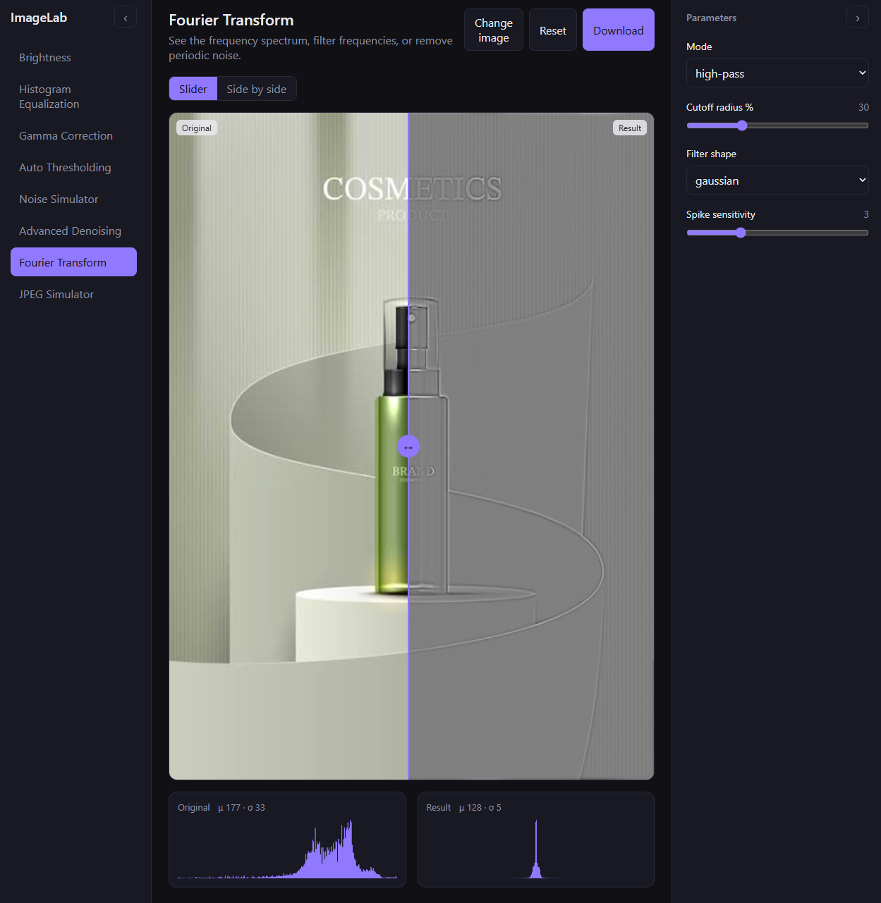
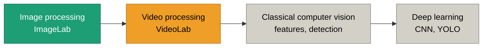
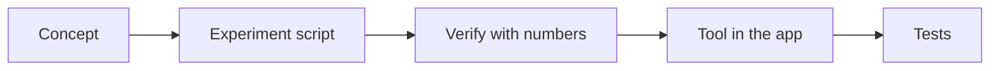

# opencvProjects

Hands-on projects to learn image processing and computer vision with Python and OpenCV. Each project is a small, tested app that turns one course topic into something you can see and interact with.



## Projects

| Project | Status | What it is | Stack |
|---------|--------|------------|-------|
| [ImageLab](./ImageLab) | Done | Web app with 8 interactive image processing tools, live preview, histograms and a before/after slider | Python, OpenCV, FastAPI, HTML/JS |
| VideoLab | Planned | Video processing counterpart of ImageLab | Python, OpenCV, FastAPI |

## What is covered so far

| Topic | Tool in ImageLab | Core idea |
|-------|------------------|-----------|
| Histograms | Histogram Equalization | spread intensities with the cumulative histogram, CLAHE |
| Point transforms | Gamma Correction | non-linear lookup table |
| Color | Auto White Balance | per-channel gain, gray world, white patch |
| Noise models | Noise Simulator | Gaussian, salt and pepper, speckle, PSNR |
| Spatial filtering | Advanced Denoising | mean, median, bilateral, non-local means |
| Segmentation | Auto Thresholding | Otsu, triangle, adaptive |
| Frequency domain | Fourier Transform | spectrum, low-pass, high-pass, periodic noise removal |
| Compression | JPEG Simulator | chroma subsampling, 8x8 DCT, quantization |

## Repository layout

```
opencvProjects/
├── ImageLab/        # finished
│   ├── app/         # FastAPI backend and tools
│   ├── static/      # frontend
│   ├── scripts/     # one experiment per concept
│   └── tests/
├── VideoLab/        # planned
└── README.md
```

## Common setup

Every project uses [uv](https://docs.astral.sh/uv/) and Python 3.12 (pinned in `.python-version`).

```powershell
winget install --id=astral-sh.uv -e
git clone <repo-url>
cd opencvProjects\ImageLab
uv sync --managed-python
uv run pytest -q
uv run uvicorn app.main:app --reload
```

`--managed-python` makes uv use its own 64-bit Python, which avoids build errors on machines with a 32-bit system Python.

## How each project is built



Every tool starts as a short script that checks the math against OpenCV, then becomes a registered tool in the app, with tests on synthetic images.